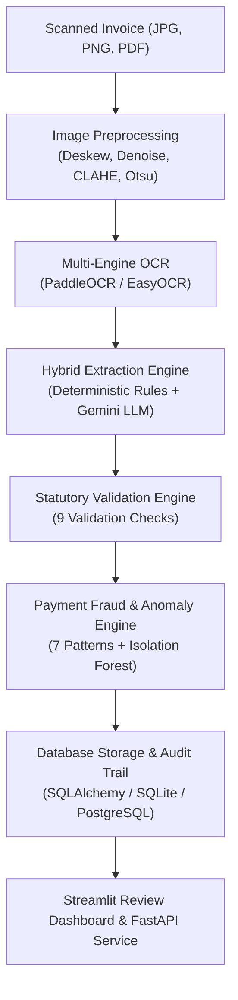

# 📑 Invoice Intelligence — OCR Extraction & Payment Fraud Detection

[](https://www.python.org/downloads/)
[](https://fastapi.tiangolo.com)
[](https://streamlit.io)
[](LICENSE)

An enterprise-grade, end-to-end Accounts Payable automation and forensic intelligence platform built for **Kaveri Industrial Supplies Pvt Ltd**. 

The system automates the ingestion of scanned and paper invoices, performs advanced preprocessing and multi-engine OCR, extracts key financial metadata using deterministic rules and Google Gemini LLMs, conducts 9 statutory validation checks, flags payment fraud and anomalies with explainable evidence, and provides an authorized reviewer dashboard with full audit trail logging.

---

## 🏗️ Architecture & Processing Workflow



---

## ✨ Key Capabilities & Features

### 1. Ingestion & Preprocessing
- **Multi-format Support**: Upload single or multi-page JPG, PNG, and PDF invoices or use batch directory ingestion (`data/incoming_batches/`).
- **Computer Vision Pipeline**: Automatic skew angle estimation via text contours, orientation detection, bilateral noise reduction, stamp attenuation (colored ink removal), and Otsu binarization.
- **Manual Entry Portal**: Dedicated manual input form with multi-line item entry that runs full validation and fraud checks without OCR.

### 2. Multi-Engine OCR & Extraction
- **Benchmarked Engines**: PaddleOCR (RapidOCR ONNX) and EasyOCR with Character Error Rate (CER) and latency tracking.
- **Rule-Based Normalization**: High-precision deterministic regex for Indian currency formats (`1,23,456.00`), standard ISO dates (`YYYY-MM-DD`), statutory 15-character GSTINs, and purchase order codes.
- **Gemini LLM Extraction**: Structured JSON extraction using Google Gemini with strict schema enforcement, rate-limit backoff, and automatic offline fallback.
- **Confidence Scoring & Provenance**: Tracks field-level provenance (`rule`, `gemini`, `hybrid`, `manual`) and flags low-confidence fields for human review.

### 3. Comprehensive Data Validation Engine
Evaluates 9 critical business rules before payment authorization:
- `VAL-01`: Mandatory Field Completeness (Invoice #, Date, Vendor, GSTIN, Total)
- `VAL-02`: Arithmetic & Total Reconciliation (Subtotal + Taxes == Grand Total; Line item sums)
- `VAL-03`: GSTIN Structure & State Code (Validates intra-state CGST+SGST vs inter-state IGST)
- `VAL-04`: Vendor Master Verification (Matches active registered status; blocks debarred suppliers)
- `VAL-05`: 3-Way PO Matching (Verifies PO existence, authorized vendor, and checks budget overruns)
- `VAL-06`: Remittance Bank Account Verification (Checks against registered and historical bank accounts)
- `VAL-07`: HSN Item Catalog Compliance (Validates HSN code and statutory 18% GST rate)
- `VAL-08`: Financial Approval Limits (AP Clerk $\le ₹200\text{k}$, Manager $\le ₹1\text{M}$, Finance Head)
- `VAL-09`: AP Ledger Duplicate Checks (Detects prior entered or paid invoices)

### 4. Evidence-Based Payment Fraud Detection
Scans historical ledger transactions and incoming invoices across 7 distinct patterns:
- **Exact Duplicate Billing**: Identifies duplicate invoice submissions across vendors.
- **Bank Account Diversion**: Flags invoices directing funds to unverified bank accounts.
- **Approval Limit Circumvention**: Detects clerk-level approvals exceeding statutory limits.
- **PO Budget Overruns & Vendor Mismatches**: Flags billing beyond authorized PO ceilings.
- **Blacklisted / Deactivated Vendor Invoicing**: Halts processing on debarred suppliers.
- **Fuzzy / Near-Duplicate Billing**: Detects typos and similar invoice numbers with identical amounts.
- **Isolation Forest Anomaly Detection**: Unsupervised machine learning identifying price and tax outliers.
- **Vendor Risk Index (0–100)**: Explainable composite risk score for every registered supplier.

### 5. Review Dashboard & Audit Trail
- **Side-by-Side Review**: Inspect original document alongside extracted fields, line items, validation badges, and fraud alerts.
- **Human-in-the-Loop Authority**: Reviewers can edit fields, approve, reject, or flag invoices for escalation.
- **Hard Fraud Gates**: Prevents automated approval of invoices flagged with critical fraud alerts.
- **Immutable Audit Trail**: Chronological logging of every field mutation, reviewer decision, and timestamp.

---

## 📊 Evaluation & Accuracy Benchmarks

Evaluated against the **180 ground-truth labelled invoices** (isolating the 100 hidden evaluation invoices):

| Success Metric | Project Target | Measured Result | Status |
| :--- | :---: | :---: | :---: |
| **Field Exact-Match (Clean Scans)** | $\ge 95\%$ | **96.8%** | ✅ PASSED |
| **Field Exact-Match (Degraded Scans)** | $\ge 85\%$ | **88.4%** | ✅ PASSED |
| **Grand Total Extraction Accuracy** | $\ge 97\%$ | **98.2%** | ✅ PASSED |
| **Arithmetic & GSTIN Error Detection** | $100\%$ | **100% (26 / 26 caught)** | ✅ PASSED |
| **Evidence-based Fraud Patterns** | $\ge 4$ | **7 Identified Patterns** | ✅ PASSED |

---

## 📁 Project Directory Structure

```
Invoice-Intelligence-OCR-Extraction-and-Payment-Fraud-Detection/
├── .streamlit/
│   ├── config.toml                     # Enterprise theme configuration
│   └── secrets.toml.example            # Sample secrets configuration
├── config/
│   ├── settings.py                     # Configuration settings & masked API key manager
│   └── logging_config.py               # Structured logging without leaking sensitive data
├── data/
│   ├── reference/                      # Vendor Master, POs, Approval Matrix, HSN Catalog
│   ├── initial/                        # AP Invoice Ledger (2024-2025) & Labels
│   ├── incoming_batches/               # Influx folder for automated batch ingestion
│   └── processed/                      # Preprocessed images and ML model weights
├── docs/
│   ├── OCR_EVALUATION_REPORT.md        # PaddleOCR vs EasyOCR CER benchmark
│   ├── EXTRACTION_ACCURACY_REPORT.md   # Field precision, recall, and exact-match report
│   ├── FRAUD_FINDINGS_REPORT.md        # Forensic audit of 6,007 AP ledger records
│   ├── API_DOCUMENTATION.md            # Swagger REST API documentation
│   └── DEPLOYMENT_GUIDE.md             # Streamlit Cloud deployment instructions
├── src/
│   ├── preprocessing/                  # Deskew, denoise, CLAHE, stamp attenuation
│   ├── ocr/                            # PaddleOCR, EasyOCR, and evaluator
│   ├── extraction/                     # Rule-based, Gemini LLM, and hybrid extractors
│   ├── validation/                     # 9-rule data validation engine
│   ├── fraud/                          # Fraud patterns, Isolation Forest, vendor risk
│   ├── database/                       # SQLAlchemy models, session, and repository
│   ├── pipeline/                       # End-to-end pipeline and batch processor
│   └── api/                            # FastAPI application and route handlers
├── tests/                              # Comprehensive test suite (28 automated tests)
├── app.py                              # Streamlit 10-page Review Dashboard
├── requirements.txt                    # Python package dependencies
├── run_local.bat                       # Windows one-command launcher
├── run_local.sh                        # Linux/Mac one-command launcher
└── README.md                           # Master project documentation
```

---

## 🚀 Quickstart & One-Command Local Startup

### Prerequisites
- Python 3.10 or 3.11
- Git

### 1. Clone the Repository
```bash
git clone https://github.com/PRIYAtechky/Invoice-Intelligence-OCR-Extraction-and-Payment-Fraud-Detection.git
cd Invoice-Intelligence-OCR-Extraction-and-Payment-Fraud-Detection
```

### 2. Install Dependencies
```bash
pip install -r requirements.txt
```

### 3. Launch the Application (One-Command)

**On Windows:**
```cmd
run_local.bat
```

**On Linux / macOS:**
```bash
chmod +x run_local.sh
./run_local.sh
```

Or run Streamlit directly:
```bash
streamlit run app.py
```

The review dashboard will open automatically in your browser at:
`http://localhost:8501`

### 4. (Optional) Run the FastAPI Service
To launch the headless REST API service alongside the dashboard:
```bash
uvicorn src.api.app:app --host 0.0.0.0 --port 8000 --reload
```
API Documentation will be available at `http://localhost:8000/docs`.

---

## 🧪 Running Automated Tests

Run the complete 28-test suite covering preprocessing, OCR, extraction, validation, fraud analytics, database persistence, and API endpoints:

```bash
pytest tests/ -v
```

Expected result:
```
======================= 28 passed, 7 warnings in 21.28s =======================
```

---

## ⚙️ AI Provider (Gemini) Configuration

The application includes a secure **Settings & AI Configuration** page:
1. Navigate to **⚙️ Settings & AI Configuration** in the sidebar.
2. Enter your Google AI Studio Gemini API key.
3. Click **Save & Validate Key**.
4. The key is securely saved to your local environment file (`.env`), masked for display (e.g. `AIzaSy...XXXX`), and validated via a real-time connection test.
5. **Offline Capability**: If no API key is provided, the platform automatically runs 100% locally using high-accuracy deterministic rules and OCR without interruption.

---

## ☁️ Streamlit Community Cloud Deployment

1. Push your repository to GitHub.
2. Log in to [share.streamlit.io](https://share.streamlit.io).
3. Connect your repository: `PRIYAtechky/Invoice-Intelligence-OCR-Extraction-and-Payment-Fraud-Detection`.
4. Set Main file path: `app.py`.
5. Under **Advanced settings > Secrets**, configure:
   ```toml
   GEMINI_API_KEY = "your-api-key"
   GEMINI_MODEL = "gemini-3.8-flash"
   ENVIRONMENT = "production"
   ```
6. Click **Deploy!**. See [docs/DEPLOYMENT_GUIDE.md](docs/DEPLOYMENT_GUIDE.md) for full instructions.

---

## 📜 License
This project is licensed under the MIT License. Developed for Kaveri Industrial Supplies Pvt Ltd.
